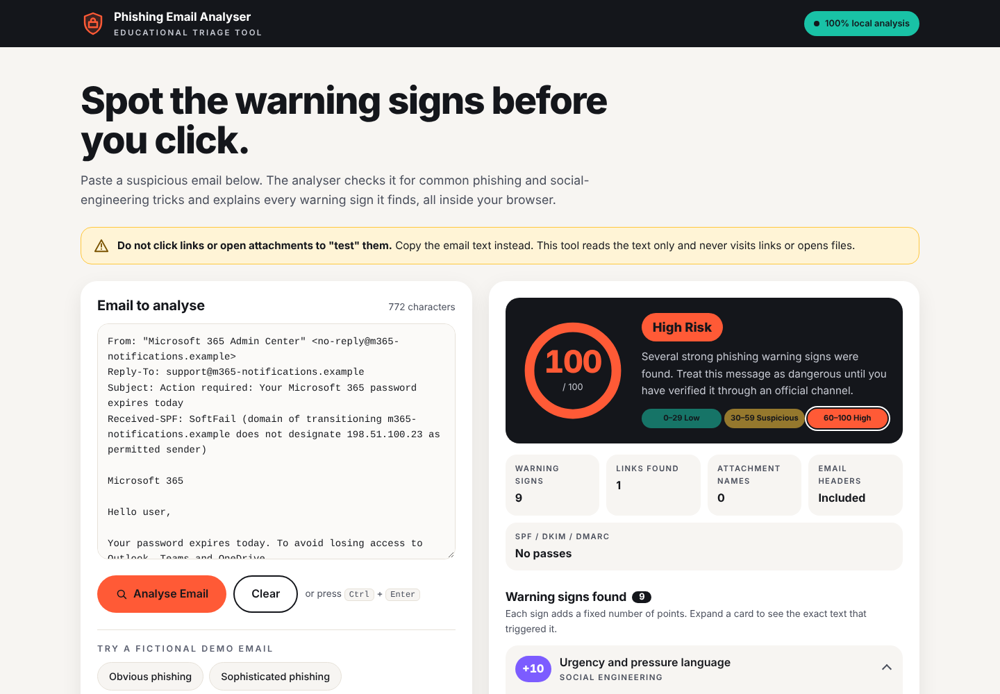
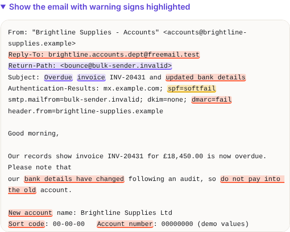
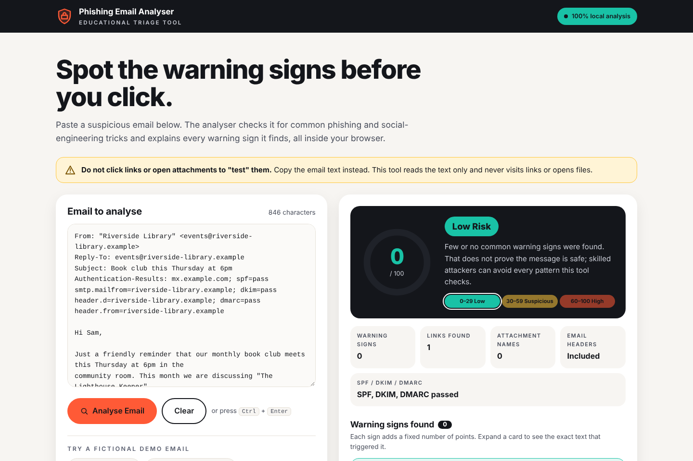
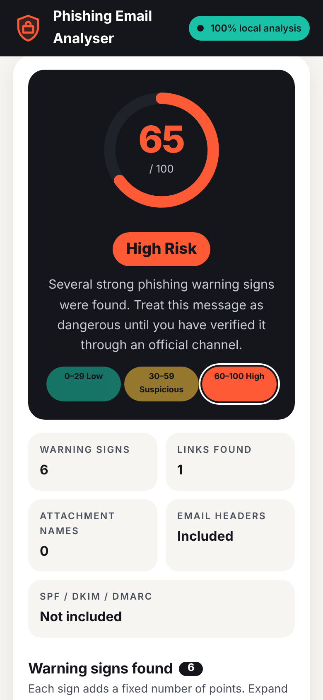

# Phishing Email Analyser

**A privacy-first, browser-based triage tool that scores suspicious emails for phishing and
social-engineering warning signs, and explains every point of the score.**

Paste an email, press **Analyse Email**, and get a 0–100 risk score, a Low / Suspicious / High
classification, the exact text behind each warning sign, and practical next steps. Everything runs
locally in the browser: the email is never uploaded anywhere.

**Live demo:** https://dhruv97270.github.io/Phishing-Email-Analyser/



> **Educational tool, not a verdict.** The analyser looks for common warning signs. It cannot
> prove whether an email is malicious or safe. Never click a link or open an attachment just to
> "test" it, and always verify important messages through the organisation's official website,
> app or a contact you already know.

---

## Why I built it

Phishing is still the most common way attacks start, and the first job of a SOC analyst is often
a fast, well-reasoned triage of a reported email. I wanted a tool that works the way an analyst
thinks: check the headers, the links, the attachments and the wording, then explain the decision
clearly enough that a non-technical colleague learns something from it.

Two principles shaped every design decision:

1. **Explainable over clever.** No black-box model. Each warning sign adds a fixed, documented
   number of points, and the report shows the exact text that triggered it.
2. **Private by design.** People paste real, sensitive emails into tools like this, so the email
   must never leave their device.

## Features

- **Risk score (0–100)** with a colour-coded gauge and three bands: Low (0–29), Suspicious (30–59), High (60–100)
- **25 detection rules** across six categories (see below), each with a plain-English "why this matters"
- **Evidence view:** the exact phrase, link, file name or header behind every finding, plus a highlighted copy of the email
- **Transparent maths:** a score breakdown table and a full list of every rule and its points
- **Tailored recommendations** (e.g. "call the supplier on a known number" for bank-detail changes, "never share a code" for MFA requests)
- **Header analysis** when headers are pasted: From vs Reply-To and Return-Path, plus SPF, DKIM and DMARC results
- **Six fictional demo emails:** obvious phishing, sophisticated phishing, fake Microsoft 365 warning, fake parcel delivery, fake invoice / BEC, and a legitimate email
- **Responsive design** for desktop and mobile

| Highlighted evidence | Legitimate email (Low Risk) | Mobile |
|---|---|---|
|  |  |  |

## What it detects

| Category | Warning signs (points) |
|---|---|
| **Social engineering** | Urgency and pressure (+10) · Threat of suspension or closure (+15) · Secrecy or authority pressure (+10) |
| **Credential theft** | Password request (+25) · MFA / verification-code request (+25) · Credential-harvesting language (+20) |
| **Financial fraud** | Gift card / crypto / wire request (+25) · Change of bank details (+25) · Payment or fee request (+10) · Unexpected invoice language (+10) |
| **Impersonation** | Brand named but not the brand's domain (+15) · Generic greeting (+5) |
| **Suspicious links** | Raw IP address (+20) · Misleading link text (+20) · Shortened link (+15) · Look-alike or odd domain (+15) |
| **Attachments** | Executable file (+30) · Enable macros / content (+25) · Macro-enabled Office file (+15) · Double extension, ISO, HTML or archive (+15) |
| **Headers & authentication** | Reply-To mismatch (+20) · DMARC fail (+20) · SPF fail (+15) · DKIM fail (+15) · Return-Path mismatch (+5) |

Each sign counts **once**, however often it appears, and the total is capped at 100. Password and
code checks ignore "never" sentences, so *"We will never ask for your password"* does not count
against an email. The full logic, with MITRE ATT&CK mapping, is in
[docs/HOW-IT-WORKS.md](docs/HOW-IT-WORKS.md).

## Privacy and security

- **No backend, database, accounts, cookies, analytics, tracking, AI service or API keys.**
- A strict **Content Security Policy** (`connect-src 'none'`, `default-src 'none'`) means the browser
  itself blocks any network connection from the page, so it could not send an email anywhere even by
  mistake. It works fully offline.
- Pasted content is rendered as **text only** (`textContent`, never `innerHTML`), so nothing in an
  email can run as code, and links are never made clickable.
- Demo emails use only domains reserved for documentation (`.example`, `example.com`, `.test`,
  `.invalid`) and the documentation IP range `192.0.2.0/24`.

## Run it

**Locally:** download or clone the repo and double-click `index.html`. No install, no build step.

**Free hosting with GitHub Pages:** in the repo go to *Settings → Pages*, choose
*Deploy from a branch*, pick `main` and `/ (root)`, and save. The site appears at
https://dhruv97270.github.io/Phishing-Email-Analyser/ within a minute or two.

**Getting full headers for better results:** Gmail: *More (⋮) → Show original*.
Outlook desktop: *File → Properties*. Outlook web: *More actions → View → View message source*.

## Tested results

| Demo email | Score | Result |
|---|---|---|
| Obvious phishing | 100 | High Risk |
| Sophisticated phishing | 80 | High Risk |
| Fake Microsoft 365 warning | 100 | High Risk |
| Fake parcel delivery | 65 | High Risk |
| Fake invoice / BEC | 100 | High Risk |
| Legitimate email | 0 | Low Risk |

Verified in Chromium at desktop (1366 px) and mobile (390 px) widths, with zero network requests
and zero console errors recorded.

## Limitations

- It reads **text patterns**. A careful attacker can write an email that triggers nothing, and a
  legitimate email can trigger some signs (a real invoice says "invoice").
- It does not visit links, check domain age or reputation, or scan attachments.
- Header checks rely on what the pasted headers say.

These are deliberate trade-offs for privacy and simplicity; in a real SOC this tool would sit
alongside sandboxing, URL reputation and threat-intel lookups.

## Roadmap

- Upload `.eml` files directly (parsed locally)
- Look-alike domain detection using edit distance (e.g. `rnicrosoft` vs `microsoft`)
- Export the report as a PDF case note
- Optional dark mode

## Project structure

```
index.html           The page
css/styles.css       Visual design (colour tokens at the top)
js/analyser.js       Detection rules and scoring (edit a rule's "points" to tune it)
js/samples.js        The six fictional demo emails
js/app.js            Connects the page to the analyser and draws the report
docs/                How-it-works guide and screenshots
```

Plain HTML, CSS and JavaScript, with no frameworks or dependencies.

## About

Built by **Dhruvkumar Prajapati** as a cybersecurity learning and portfolio project: requirements,
detection scope, scoring model, privacy constraints and test cases.

[LinkedIn](https://www.linkedin.com/in/dhruvkumar-prajapati-197b84229)
